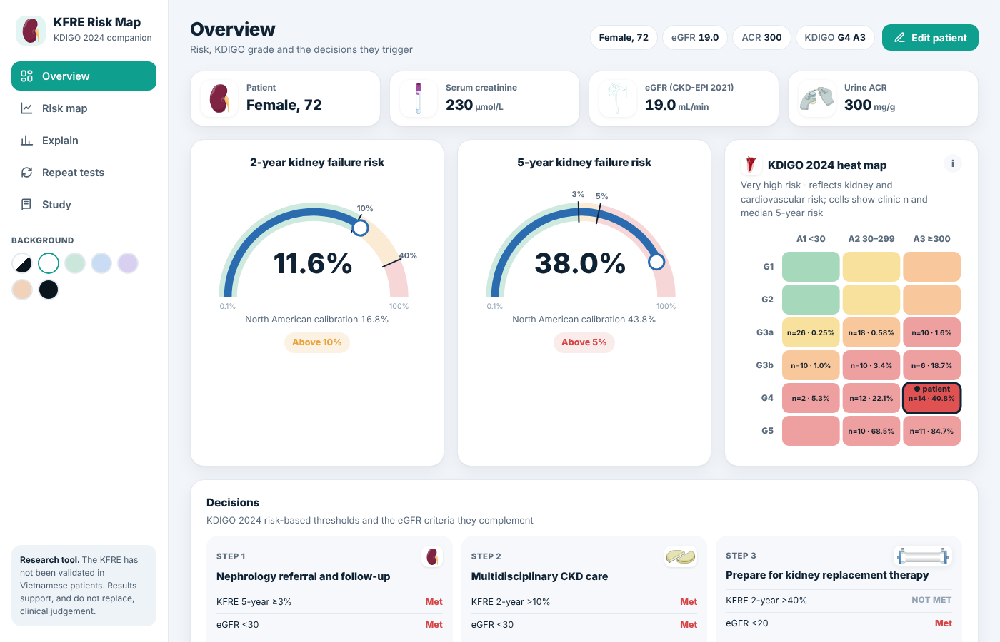

# KFRE Risk Map

[English](README.md) · [Tiếng Việt](README.vi.md) · [日本語](README.ja.md) · [中文](README.zh.md) · **Français**

[](https://doi.org/10.5281/zenodo.24150074)

**KFRE Risk Map** est un outil pour navigateur associé à une étude transversale de 129 patients ambulatoires atteints de maladie rénale chronique (MRC) G3–G5 au Lanh Binh Thang General Hospital, Hô Chi Minh-Ville, Viêt Nam. Il calcule le risque d’insuffisance rénale à 2 et 5 ans avec l’équation de risque à 4 variables (KFRE) et le confronte à la carte thermique DFGe–albuminurie de KDIGO 2024.

**Version en ligne :** https://kfreriskmap.netlify.app/?lang=fr

L’interface est disponible en anglais (par défaut), vietnamien, japonais, chinois et français. Choisissez la langue dans la barre latérale (dans le panneau patient sur téléphone) ou ajoutez `?lang=` à l’adresse ; le choix est mémorisé par le navigateur.



> **Outil de recherche et d’enseignement.** Le KFRE n’a pas été validé chez des patients vietnamiens. Les résultats aident le jugement clinique sans le remplacer. Ce logiciel n’est pas un dispositif médical.

## Écrans

| Écran | Contenu |
|---|---|
| Vue d’ensemble | Jauges du risque à 2 et 5 ans, carte thermique KDIGO avec la cellule du patient, les trois décisions KDIGO 2024 (critère KFRE à côté du critère de DFGe) et la position du patient parmi les patients de la consultation |
| Carte de risque | Plan DFGe–RAC avec cellules KDIGO et courbes d’iso-risque KFRE pour l’âge et le sexe du patient, avec calibration nord-américaine en option |
| Explication | Cascade du patient de référence du KFRE jusqu’à ce patient, et courbes de simulation pour le DFGe, le RAC, l’âge et le sexe |
| Tests répétés | Probabilité de franchir chaque seuil lors d’un nouveau dosage de créatinine et de RAC (3 000 répétitions simulées) |
| Étude | Principaux résultats, graphiques de la cohorte, méthodes, équations et références |

Données : âge, sexe, créatinine sérique (µmol/L ou mg/dL) et l’un des tests urinaires suivants : RAC, albumine et créatinine urinaires, ou RPC (converti en RAC par l’équation de Sumida 2020). Le DFGe est calculé par l’équation CKD-EPI 2021 à la créatinine.

## Exécution en local

Aucune compilation n’est nécessaire. Ouvrez `index.html` dans un navigateur ou servez le dossier :

```bash
python3 -m http.server 8000
# puis ouvrez http://localhost:8000
```

## Organisation du dépôt

```
index.html              l’application (React 18 UMD, sans compilation ; cinq langues d’interface)
README.*.md             ce README dans les autres langues
assets/img/             illustrations (voir ATTRIBUTION.md)
assets/js/cohort.js     données anonymisées de la consultation (facultatif, voir ci-dessous)
vendor/react/           React 18.3.1 (MIT)
netlify.toml            configuration Netlify
CITATION.cff            métadonnées de citation (GitHub « Cite this repository »)
.zenodo.json            métadonnées utilisées par Zenodo pour archiver une version
```

## Données de la consultation

`assets/js/cohort.js` contient, pour chacun des 129 patients de l’étude, le DFGe, le RAC urinaire, le stade KDIGO et le risque KFRE, sans identifiant, date ni donnée démographique. Il alimente la comparaison avec la consultation et les graphiques de la cohorte. Pour publier l’outil sans ces données, remplacez le contenu du fichier par un commentaire vide : le calculateur fonctionne toujours et les graphiques de la cohorte sont masqués.

## Citer

Nguyễn TTA, Lâm HT, Huỳnh HN, Trần NTH, Lâm KT, Lê VC. KFRE Risk Map (version 2.3.0) [software]. Zenodo; 2026. doi:10.5281/zenodo.24150074

## Références principales


1. Tangri N, et al. A predictive model for progression of chronic kidney disease to kidney failure. JAMA. 2011;305:1553–9.
2. Tangri N, et al. Multinational assessment of accuracy of equations for predicting risk of kidney failure: a meta-analysis. JAMA. 2016;315:164–74.
3. KDIGO CKD Work Group. KDIGO 2024 clinical practice guideline for the evaluation and management of chronic kidney disease. Kidney Int. 2024;105(4S):S117–S314.
4. Inker LA, et al. New creatinine- and cystatin C-based equations to estimate GFR without race. N Engl J Med. 2021;385:1737–49.
5. Sumida K, et al. Conversion of urine protein–creatinine ratio or urine dipstick protein to urine albumin–creatinine ratio for use in CKD screening and prognosis. Ann Intern Med. 2020;173:426–35.
6. McCudden C, et al. Individual patient variability with the application of the kidney failure risk equation in advanced CKD. PLoS One. 2018;13:e0198456.

## Licence

Code source : MIT (voir `LICENSE`). Les illustrations et composants tiers conservent leur propre licence (voir `ATTRIBUTION.md`).
