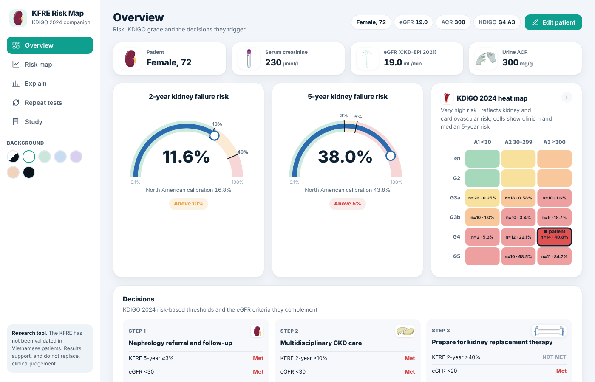

# KFRE Risk Map

[English](README.md) · [Tiếng Việt](README.vi.md) · **日本語** · [中文](README.zh.md) · [Français](README.fr.md)

[](https://doi.org/10.5281/zenodo.24150074)

**KFRE Risk Map** は、ベトナム・ホーチミン市のLanh Binh Thang General Hospitalにおける慢性腎臓病（CKD）G3–G5の外来患者129人を対象とした横断研究に付随するブラウザツールです。4変数の腎不全リスク式（KFRE）で2年・5年の腎不全リスクを計算し、KDIGO 2024のeGFR–アルブミン尿ヒートマップと並べて示します。

**オンライン版：** https://kfreriskmap.netlify.app/?lang=ja

画面は英語（既定）、ベトナム語、日本語、中国語、フランス語に対応しています。サイドバー（スマートフォンでは患者パネル）で言語を選ぶか、アドレスに `?lang=` を付けてください。選択はブラウザに記憶されます。



> **研究・教育用ツール。** KFREはベトナム人患者では検証されていません。結果は臨床判断を支援するもので、代替するものではありません。本ソフトウェアは医療機器ではありません。

## 各画面の内容

| 画面 | 内容 |
|---|---|
| 概要 | 2年・5年リスクのゲージ、患者のセルを示したKDIGOヒートマップ、KDIGO 2024の3つの判断（KFRE基準とeGFR基準を併記）、外来患者の中での位置 |
| リスクマップ | KDIGOセルと、患者の年齢・性別に応じたKFRE等リスク線を重ねたeGFR–ACR平面（北米較正も選択可） |
| 解説 | KFREの基準患者からこの患者までのウォーターフォール図と、eGFR・ACR・年齢・性別の仮定曲線 |
| 再検査 | クレアチニンとACRを再検したときに各閾値を超える確率（3,000回のシミュレーション） |
| 研究 | 主な結果、対象集団の図、方法、式、参考文献 |

入力：年齢、性別、血清クレアチニン（µmol/L または mg/dL）、および尿ACR、尿アルブミンと尿クレアチニン、尿PCR（Sumida 2020の式でACRに換算）のいずれか。eGFRは2021年CKD-EPIクレアチニン式で計算します。

## ローカルで実行

ビルドは不要です。ブラウザで `index.html` を開くか、フォルダを配信してください：

```bash
python3 -m http.server 8000
# その後 http://localhost:8000 を開く
```

## リポジトリ構成

```
index.html              アプリ本体（React 18 UMD、ビルド不要、5言語対応）
README.*.md             他言語版のREADME
assets/img/             イラスト（ATTRIBUTION.mdを参照）
assets/js/cohort.js     匿名化した外来データ（任意、下記参照）
vendor/react/           React 18.3.1 (MIT)
netlify.toml            Netlifyの設定
CITATION.cff            引用メタデータ（GitHubの“Cite this repository”）
.zenodo.json            リリースをアーカイブする際にZenodoが使うメタデータ
```

## 外来データ

`assets/js/cohort.js` には研究患者129人それぞれのeGFR、尿ACR、KDIGO分類、KFREリスクが含まれ、識別情報、日付、人口統計情報は含まれません。外来患者との比較と対象集団の図に使います。データなしで公開する場合は、ファイルの中身を空のコメントに置き換えてください。計算機能はそのまま動作し、対象集団の図は非表示になります。

## 引用

Nguyễn TTA, Lâm HT, Huỳnh HN, Trần NTH, Lâm KT, Lê VC. KFRE Risk Map (version 2.3.0) [software]. Zenodo; 2026. doi:10.5281/zenodo.24150074

## 主要文献


1. Tangri N, et al. A predictive model for progression of chronic kidney disease to kidney failure. JAMA. 2011;305:1553–9.
2. Tangri N, et al. Multinational assessment of accuracy of equations for predicting risk of kidney failure: a meta-analysis. JAMA. 2016;315:164–74.
3. KDIGO CKD Work Group. KDIGO 2024 clinical practice guideline for the evaluation and management of chronic kidney disease. Kidney Int. 2024;105(4S):S117–S314.
4. Inker LA, et al. New creatinine- and cystatin C-based equations to estimate GFR without race. N Engl J Med. 2021;385:1737–49.
5. Sumida K, et al. Conversion of urine protein–creatinine ratio or urine dipstick protein to urine albumin–creatinine ratio for use in CKD screening and prognosis. Ann Intern Med. 2020;173:426–35.
6. McCudden C, et al. Individual patient variability with the application of the kidney failure risk equation in advanced CKD. PLoS One. 2018;13:e0198456.

## ライセンス

ソースコード：MIT（`LICENSE`を参照）。イラストと第三者のコンポーネントはそれぞれのライセンスに従います（`ATTRIBUTION.md`を参照）。
