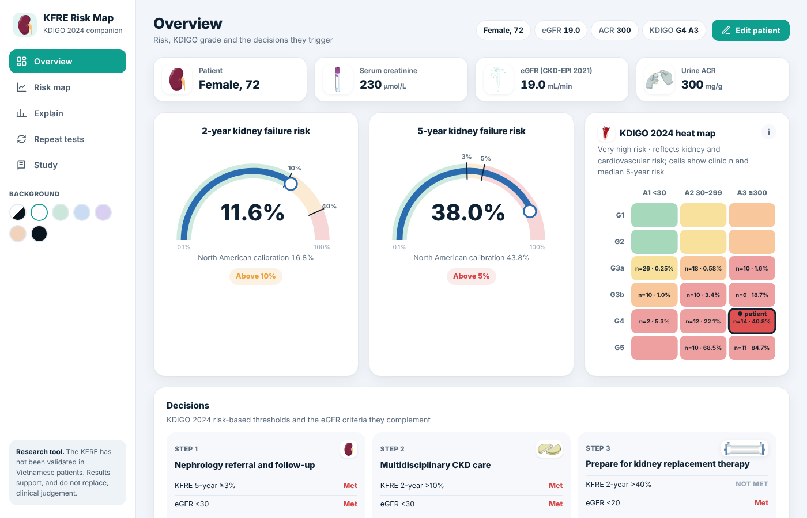

# KFRE Risk Map

[](https://doi.org/10.5281/zenodo.XXXXXXX)

**KFRE Risk Map** is a browser-based companion tool to a cross-sectional study of 129 outpatients with chronic kidney disease (CKD) G3–G5 at Lanh Binh Thang General Hospital, Ho Chi Minh City, Vietnam. It calculates 2- and 5-year kidney failure risk with the 4-variable Kidney Failure Risk Equation (KFRE) and sets the result against the KDIGO 2024 eGFR–albuminuria heat map.

**Live version:** https://YOUR-SITE.netlify.app



> **Research and education tool.** The KFRE has not been validated in Vietnamese patients. Results support, and do not replace, clinical judgement. This software is not a medical device.

## What it shows

| Screen | Content |
|---|---|
| Overview | Gauges for 2- and 5-year risk, the full KDIGO heat map with the patient's cell, the three KDIGO 2024 decisions (KFRE criterion next to the eGFR criterion), and the patient's position among clinic patients |
| Risk map | eGFR–ACR plane with KDIGO cells and KFRE iso-risk contours for the patient's age and sex, with optional North American calibration |
| Explain | Waterfall from the KFRE reference patient to this patient, and what-if curves for eGFR, ACR, age and sex |
| Repeat tests | Probability of crossing each threshold on a repeat test of creatinine and ACR (3,000 simulated repeats) |
| Study | Main findings, cohort charts, methods, equations and references |

Inputs: age, sex, serum creatinine (µmol/L or mg/dL) and one of urine ACR, urine albumin plus creatinine, or urine PCR (converted to ACR with the Sumida 2020 equation). eGFR is calculated with the 2021 CKD-EPI creatinine equation.

## Run locally

No build step is needed. Open `index.html` in a browser, or serve the folder:

```bash
python3 -m http.server 8000
# then open http://localhost:8000
```

## Repository layout

```
index.html              the application (React 18 UMD, no build step)
assets/img/             illustrations (see ATTRIBUTION.md)
assets/js/cohort.js     de-identified clinic data (optional, see below)
vendor/react/           React 18.3.1 production builds (MIT)
netlify.toml            Netlify configuration
CITATION.cff            citation metadata (GitHub "Cite this repository")
.zenodo.json            metadata used by Zenodo when archiving a release
```

## Clinic data

`assets/js/cohort.js` contains, for each of the 129 study patients, eGFR, urine ACR, KDIGO grade and KFRE risk, with no identifiers, dates or demographics. It powers the clinic comparison and cohort charts. To publish the tool without it, replace the file contents with an empty comment; the calculator keeps working and the cohort charts are hidden.

## How to cite

Nguyễn TTA, Lâm HT, Huỳnh HN, Trần NTH, Lâm KT, Lê VC. KFRE Risk Map (version 2.2.0) [software]. Zenodo; 2026. doi:10.5281/zenodo.XXXXXXX

## Key references

1. Tangri N, et al. A predictive model for progression of chronic kidney disease to kidney failure. JAMA. 2011;305:1553–9.
2. Tangri N, et al. Multinational assessment of accuracy of equations for predicting risk of kidney failure: a meta-analysis. JAMA. 2016;315:164–74.
3. KDIGO CKD Work Group. KDIGO 2024 clinical practice guideline for the evaluation and management of chronic kidney disease. Kidney Int. 2024;105(4S):S117–S314.
4. Inker LA, et al. New creatinine- and cystatin C-based equations to estimate GFR without race. N Engl J Med. 2021;385:1737–49.
5. Sumida K, et al. Conversion of urine protein–creatinine ratio or urine dipstick protein to urine albumin–creatinine ratio for use in CKD screening and prognosis. Ann Intern Med. 2020;173:426–35.
6. McCudden C, et al. Individual patient variability with the application of the kidney failure risk equation in advanced CKD. PLoS One. 2018;13:e0198456.

## Licence

Source code: MIT (see `LICENSE`). Illustrations and third-party components keep their own licences (see `ATTRIBUTION.md`).
