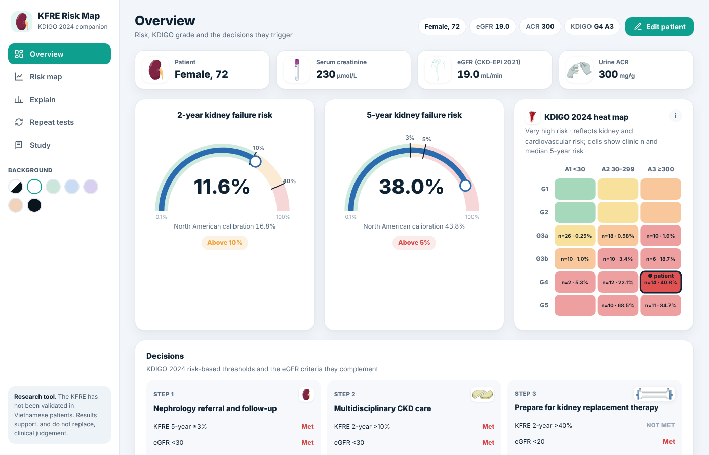

# KFRE Risk Map

[English](README.md) · **Tiếng Việt** · [日本語](README.ja.md) · [中文](README.zh.md) · [Français](README.fr.md)

[](https://doi.org/10.5281/zenodo.24150074)

**KFRE Risk Map** là công cụ chạy trên trình duyệt đi kèm một nghiên cứu cắt ngang trên 129 bệnh nhân ngoại trú bệnh thận mạn (CKD) G3–G5 tại Bệnh viện Đa khoa Lãnh Binh Thăng, Thành phố Hồ Chí Minh, Việt Nam. Công cụ tính nguy cơ suy thận 2 năm và 5 năm bằng phương trình nguy cơ suy thận 4 biến (KFRE) và đặt kết quả cạnh bản đồ nhiệt eGFR–albumin niệu của KDIGO 2024.

**Bản trực tuyến:** https://kfreriskmap.netlify.app/?lang=vi

Giao diện có 5 ngôn ngữ: tiếng Anh (mặc định), tiếng Việt, tiếng Nhật, tiếng Trung và tiếng Pháp. Chọn ngôn ngữ ở thanh bên (trên điện thoại: trong bảng bệnh nhân) hoặc thêm `?lang=` vào địa chỉ; trình duyệt sẽ ghi nhớ lựa chọn.



> **Công cụ nghiên cứu và giảng dạy.** KFRE chưa được kiểm định ở bệnh nhân Việt Nam. Kết quả hỗ trợ, không thay thế, đánh giá lâm sàng. Phần mềm này không phải thiết bị y tế.

## Nội dung các màn hình

| Màn hình | Nội dung |
|---|---|
| Tổng quan | Đồng hồ nguy cơ 2 năm và 5 năm, bản đồ nhiệt KDIGO với ô của bệnh nhân, ba quyết định của KDIGO 2024 (tiêu chí KFRE bên cạnh tiêu chí eGFR) và vị trí của bệnh nhân so với bệnh nhân phòng khám |
| Bản đồ nguy cơ | Mặt phẳng eGFR–ACR với các ô KDIGO và đường đồng mức nguy cơ KFRE theo tuổi và giới của bệnh nhân, có tùy chọn hiệu chỉnh Bắc Mỹ |
| Giải thích | Biểu đồ thác nước từ bệnh nhân tham chiếu của KFRE đến bệnh nhân này, và các đường giả định theo eGFR, ACR, tuổi và giới |
| Xét nghiệm lặp lại | Xác suất vượt từng ngưỡng khi làm lại creatinin và ACR (3.000 lần lặp mô phỏng) |
| Nghiên cứu | Kết quả chính, biểu đồ nhóm bệnh nhân, phương pháp, phương trình và tài liệu tham khảo |

Dữ liệu đầu vào: tuổi, giới, creatinin huyết thanh (µmol/L hoặc mg/dL) và một trong các xét nghiệm nước tiểu: ACR, albumin cùng creatinin niệu, hoặc PCR (quy đổi sang ACR theo phương trình Sumida 2020). eGFR được tính bằng phương trình creatinin CKD-EPI 2021.

## Chạy trên máy

Không cần bước build. Mở `index.html` bằng trình duyệt, hoặc chạy một máy chủ tĩnh:

```bash
python3 -m http.server 8000
# rồi mở http://localhost:8000
```

## Cấu trúc kho mã

```
index.html              ứng dụng (React 18 UMD, không cần build; 5 ngôn ngữ giao diện)
README.*.md             README bằng các ngôn ngữ khác
assets/img/             hình minh họa (xem ATTRIBUTION.md)
assets/js/cohort.js     dữ liệu phòng khám đã khử định danh (tùy chọn, xem dưới)
vendor/react/           React 18.3.1 (MIT)
netlify.toml            thiết lập Netlify
CITATION.cff            thông tin trích dẫn (GitHub “Cite this repository”)
.zenodo.json            thông tin Zenodo dùng khi lưu trữ một phiên bản
```

## Dữ liệu phòng khám

`assets/js/cohort.js` chứa eGFR, ACR niệu, phân độ KDIGO và nguy cơ KFRE của từng bệnh nhân trong 129 bệnh nhân nghiên cứu, không có thông tin định danh, ngày tháng hay nhân khẩu học. File này dùng cho phần so sánh với phòng khám và các biểu đồ nhóm bệnh nhân. Muốn công bố công cụ mà không kèm dữ liệu, thay nội dung file bằng một dòng chú thích trống; phần tính toán vẫn hoạt động và các biểu đồ nhóm bệnh nhân sẽ ẩn.

## Trích dẫn

Nguyễn TTA, Lâm HT, Huỳnh HN, Trần NTH, Lâm KT, Lê VC. KFRE Risk Map (version 2.3.0) [software]. Zenodo; 2026. doi:10.5281/zenodo.24150074

## Tài liệu tham khảo chính


1. Tangri N, et al. A predictive model for progression of chronic kidney disease to kidney failure. JAMA. 2011;305:1553–9.
2. Tangri N, et al. Multinational assessment of accuracy of equations for predicting risk of kidney failure: a meta-analysis. JAMA. 2016;315:164–74.
3. KDIGO CKD Work Group. KDIGO 2024 clinical practice guideline for the evaluation and management of chronic kidney disease. Kidney Int. 2024;105(4S):S117–S314.
4. Inker LA, et al. New creatinine- and cystatin C-based equations to estimate GFR without race. N Engl J Med. 2021;385:1737–49.
5. Sumida K, et al. Conversion of urine protein–creatinine ratio or urine dipstick protein to urine albumin–creatinine ratio for use in CKD screening and prognosis. Ann Intern Med. 2020;173:426–35.
6. McCudden C, et al. Individual patient variability with the application of the kidney failure risk equation in advanced CKD. PLoS One. 2018;13:e0198456.

## Giấy phép

Mã nguồn: MIT (xem `LICENSE`). Hình minh họa và các thành phần của bên thứ ba giữ giấy phép riêng (xem `ATTRIBUTION.md`).
