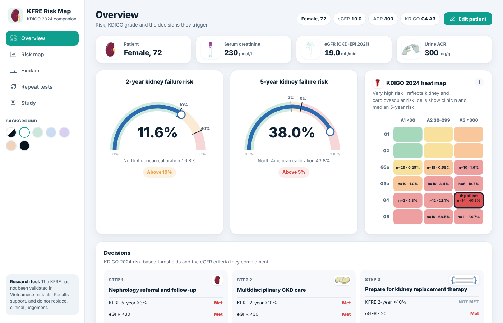

# KFRE Risk Map

[English](README.md) · [Tiếng Việt](README.vi.md) · [日本語](README.ja.md) · **中文** · [Français](README.fr.md)

[](https://doi.org/10.5281/zenodo.24150074)

**KFRE Risk Map** 是一个浏览器工具，配套越南胡志明市Lanh Binh Thang General Hospital对129名慢性肾脏病（CKD）G3–G5门诊患者开展的横断面研究。它用4变量肾衰竭风险方程（KFRE）计算2年和5年肾衰竭风险，并与KDIGO 2024 eGFR–白蛋白尿热图对照显示。

**在线版本：** https://kfreriskmap.netlify.app/?lang=zh

界面支持英语（默认）、越南语、日语、中文和法语。可在侧边栏（手机上在患者面板中）选择语言，或在网址后加 `?lang=`；浏览器会记住您的选择。



> **研究与教学工具。** KFRE尚未在越南患者中验证。结果用于辅助而非取代临床判断。本软件不是医疗器械。

## 各页面内容

| 页面 | 内容 |
|---|---|
| 概览 | 2年和5年风险仪表、标出患者所在单元格的KDIGO热图、KDIGO 2024的三项决策（KFRE标准与eGFR标准并列）以及患者在门诊患者中的位置 |
| 风险图 | 带KDIGO单元格和按患者年龄、性别绘制的KFRE等风险线的eGFR–ACR平面，可选北美校准 |
| 解释 | 从KFRE参照患者到本患者的瀑布图，以及eGFR、ACR、年龄和性别的假设曲线 |
| 重复检测 | 复查肌酐和ACR时超过各阈值的概率（3,000次模拟） |
| 研究 | 主要结果、队列图表、方法、公式和参考文献 |

输入：年龄、性别、血肌酐（µmol/L 或 mg/dL），以及尿ACR、尿白蛋白加尿肌酐或尿PCR（按Sumida 2020方程换算为ACR）之一。eGFR采用2021年CKD-EPI肌酐方程计算。

## 本地运行

无需构建。在浏览器中打开 `index.html`，或启动一个静态服务器：

```bash
python3 -m http.server 8000
# 然后打开 http://localhost:8000
```

## 仓库结构

```
index.html              应用程序（React 18 UMD，无需构建；5种界面语言）
README.*.md             其他语言版本的README
assets/img/             插图（见 ATTRIBUTION.md）
assets/js/cohort.js     去标识化门诊数据（可选，见下文）
vendor/react/           React 18.3.1 (MIT)
netlify.toml            Netlify设置
CITATION.cff            引用元数据（GitHub“Cite this repository”）
.zenodo.json            Zenodo存档版本时使用的元数据
```

## 门诊数据

`assets/js/cohort.js` 包含129名研究患者各自的eGFR、尿ACR、KDIGO分级和KFRE风险，不含身份信息、日期或人口学资料，用于门诊比较和队列图表。若要在不含该数据的情况下发布，请将文件内容替换为空注释；计算功能照常运行，队列图表将被隐藏。

## 引用

Nguyễn TTA, Lâm HT, Huỳnh HN, Trần NTH, Lâm KT, Lê VC. KFRE Risk Map (version 2.3.0) [software]. Zenodo; 2026. doi:10.5281/zenodo.24150074

## 主要参考文献


1. Tangri N, et al. A predictive model for progression of chronic kidney disease to kidney failure. JAMA. 2011;305:1553–9.
2. Tangri N, et al. Multinational assessment of accuracy of equations for predicting risk of kidney failure: a meta-analysis. JAMA. 2016;315:164–74.
3. KDIGO CKD Work Group. KDIGO 2024 clinical practice guideline for the evaluation and management of chronic kidney disease. Kidney Int. 2024;105(4S):S117–S314.
4. Inker LA, et al. New creatinine- and cystatin C-based equations to estimate GFR without race. N Engl J Med. 2021;385:1737–49.
5. Sumida K, et al. Conversion of urine protein–creatinine ratio or urine dipstick protein to urine albumin–creatinine ratio for use in CKD screening and prognosis. Ann Intern Med. 2020;173:426–35.
6. McCudden C, et al. Individual patient variability with the application of the kidney failure risk equation in advanced CKD. PLoS One. 2018;13:e0198456.

## 许可

源代码：MIT（见 `LICENSE`）。插图和第三方组件遵循各自的许可（见 `ATTRIBUTION.md`）。
